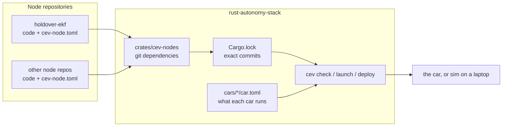

# Node contracts: overview

This page explains, in one sitting, how the autonomy stack pulls in node
repositories and how it checks that they fit together. The details are in the
pages linked at the bottom.

**Words used here**

- **Node**: one program that runs on the car, such as the state estimator.
  Each node lives in its own git repository.
- **Topic**: a named data stream between nodes, such as `sensors/imu`. Nodes
  talk over [Zenoh](https://zenoh.io), a publish/subscribe library, so a
  topic name is a Zenoh "key".
- **Contract**: a small file, `cev-node.toml`, that each node ships. It says
  what the node reads, what it writes, how fast, and where it can run.
- **Car**: one entry in `cars/` (`merceves`, `sim`). It says which nodes that
  vehicle runs.
- **Mode**: what the car is doing: `teleop`, `autonomous` or `efficiency`.

## The problem

On `main`, the stack cloned node repos with a separate tool (gitman) and
symlinked them into one Cargo workspace. Each `car.toml` said how to *start*
each node, but nothing said what a node *needs* or *produces*. So nothing
could tell you, before you were at the car, that:

- the estimator wants IMU data at 200 Hz but nothing publishes it,
- two nodes disagree on a topic name (`/sensors/imu` vs `sensors/imu`),
- a node needs a GPU and the car has none,
- a node was never meant to run in the mode the car is in.

## The idea

Every node repository describes itself in a `cev-node.toml` contract. The
stack never moves data between nodes; it only reads the contracts and refuses
setups that cannot work. Getting and pinning the nodes is plain Cargo: each
node repo is a git dependency, and `Cargo.lock` is the record of exactly which
commit of every node a release uses.

In short:

1. A node repo adds a `cev-node.toml` next to its `Cargo.toml`.
2. The stack lists the repo in `crates/cev-nodes/Cargo.toml`.
3. A car names the node in its `car.toml`.
4. `cargo cev check` loads every contract and reports every problem at once.

Today the check covers each contract on its own and each contract against its
car (modes, GPU). Checking nodes against *each other* (does every input have a
producer of the right type and rate?) is the next big piece and is **planned,
not built**. See [Status](node-contracts/design-and-status.md#status).

## Pages

| Page | Read it when |
| --- | --- |
| [Contracts](node-contracts/contracts.md) | You want to know what goes in `cev-node.toml`, with a real example |
| [Checking](node-contracts/checking.md) | You want to know what `cargo cev check` does and what its errors mean |
| [Adding a node](node-contracts/adding-a-node.md) | You are bringing a new node or repo into the stack |
| [Design and status](node-contracts/design-and-status.md) | You are asking "why not X?", or what is done and what is next |

For setup and day-to-day commands, see [RUNNING.md](../RUNNING.md). For the
repository layout, see the root [README.md](../README.md).
