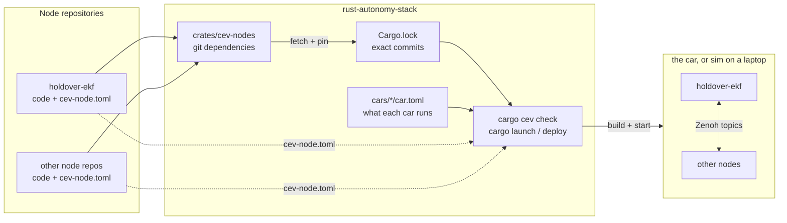

# Node contracts: overview

This page explains, in one sitting, how the autonomy stack pulls in node
repositories and how it checks that they fit together. The details are in the
pages linked at the bottom.

**Words used here**

- **Node**: one program that runs on the car, such as the state estimator.
  Each node lives in its own git repository.
- **Package**: what Cargo builds: a folder with its own `Cargo.toml`. Every
  node is one package; one repository can hold several.
- **Topic**: a named data stream between nodes, such as `sensors/imu`. Nodes
  talk over [Zenoh](https://zenoh.io), a publish/subscribe library.
- **Contract**: a small file, `cev-node.toml`, that each node ships. It says
  what the node reads, what it writes, how fast, and where it can run.
- **Car**: one entry in `cars/` (`merceves`, `sim`). It says which nodes that
  vehicle runs.
- **Mode**: what the car is doing: `teleop`, `autonomous` or `efficiency`.
- **cev**: the stack's command-line tool, run through Cargo:
  `cargo cev check`, `cargo launch <car>`, `cargo deploy <car>`.

## The problem

Before this, `car.toml` said how to *start* each node, but nothing said what a
node *needs* or *produces*. So nothing could tell you, before you were at the
car, that:

- the estimator wants IMU data at 200 Hz but nothing publishes it,
- two nodes disagree on a topic name (`/sensors/imu` vs `sensors/imu`),
- a node needs a GPU and the car has none,
- a node was never meant to run in the mode the car is in.

## The idea

Every node repository describes itself in a `cev-node.toml` contract. A short
one, for a planner:

```toml
contract_version = 1
role = "planning"
modes = ["autonomous"]

[compute]
device = "cpu"

[[inputs]]
topic = "estimation/state"
type = "StateEstimate"
min_rate_hz = 50.0
```

In words: "I am a planner. I run only in autonomous mode, on the CPU, and I
need a state estimate at 50 Hz or faster."

The stack never moves data between nodes; on the car they talk to each other
directly over Zenoh. The stack only reads the contracts and refuses setups
that cannot work. Getting and pinning the nodes is plain Cargo: each node repo
is a *git dependency* (Cargo downloads it from its git URL instead of from
crates.io), and `Cargo.lock` records exactly which commit of every node a
release uses.



Today the check covers each contract on its own and each contract against its
car. Checking nodes against *each other* is planned; see
[Not checked yet](node-contracts/checking.md#not-checked-yet).

## Pages

| Page | Read it when |
| --- | --- |
| [Contracts](node-contracts/contracts.md) | You want to know what goes in `cev-node.toml`, with a real example |
| [Checking](node-contracts/checking.md) | You want to know what `cargo cev check` does and what its errors mean |
| [Adding a node](node-contracts/adding-a-node.md) | You are bringing a new node or repo into the stack |
| [Design and status](node-contracts/design-and-status.md) | You are asking "why not X?", or what is done and what is next |

For setup and day-to-day commands, see [RUNNING.md](../RUNNING.md). For the
repository layout, see the root [README.md](../README.md).
