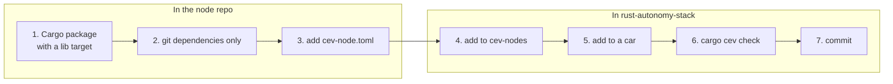

# Adding a node

Two repositories change: the node's own repo, and this one. The example
below adds a made-up package `my-planner` from a repo `my-planner`; swap in
your own names.



## In the node repo

**1. Be a Cargo package with a library target.** An empty `src/lib.rs` is
enough. Cargo quietly ignores a git dependency that has no library, and then
`cargo build -p my-planner` says the package does not exist. Every node is a
Cargo package; a program in another language joins through a small Rust
wrapper crate. C++ built from a `build.rs` (as `zed-reader` does) is fine.

**2. Depend on other repos by `git`, never by `path`.** A
`path = "../rust-autonomy-sensors/..."` points at nothing once Cargo checks
your repo out somewhere else, and then the whole stack fails to resolve. Use
the same URL and branch the stack uses, so Cargo builds one copy. For example,
`holdover-ekf` uses:

```toml
sensor-defs = { git = "https://github.com/cornellev/rust-autonomy-sensors", branch = "extra-sensors"}
```

**3. Add `cev-node.toml`** next to the package's `Cargo.toml`. Start from
[holdover-ekf's contract](contracts.md#a-real-example) and change it. A short
one:

```toml
contract_version = 1
role = "planning"
modes = ["autonomous"]

[compute]
device = "cpu"

[[inputs]]
topic = "estimation/state"
type = "StateEstimate"
min_rate_hz = 50.0
```

If a repo holds several nodes (a Cargo workspace, like
`rust-autonomy-sensors`), each node crate gets its own `cev-node.toml`. If one
crate has several binaries, `[run] bin = "..."` picks one.

Push your branch.

## In rust-autonomy-stack

**4. Pull the repo in.** Add one line to `crates/cev-nodes/Cargo.toml`, next
to the existing ones:

```toml
holdover-ekf = { git = "https://github.com/cornellev/holdover-ekf", branch = "sensor-integration" }
my-planner = { git = "https://github.com/cornellev/my-planner", branch = "main" }
```

Also add a row to the node table in the root [README.md](../../README.md#the-nodes).

**5. Put it on a car.** Add a `[[nodes]]` entry to each `cars/<car>/car.toml`
that should run it:

```toml
[[nodes]]
name = "planning"
package = "my-planner"
```

> **Planned.** Today a `[[nodes]]` entry still has `name` and may also set
> `bin`, `command` or `args`. The plan is for an entry to name only its
> `package` (plus optional `env` and `enabled`), with how-to-run coming from
> the contract instead.

**6. Check.**

```bash
cargo cev check
cargo test
```

The first cargo command fetches the new repo into `~/.cargo/git` and records
its commit in `Cargo.lock`. Fix whatever `check` reports; see
[Checking](checking.md) for what the messages mean.

**7. Commit** `crates/cev-nodes/Cargo.toml`, `Cargo.lock`, the car files and
the README row together. The `Cargo.lock` change is the record of which
commit of your node this stack release uses.

## Working on the node and the stack at once

To make the stack build your local clone instead of the pinned commit, add a
`[patch]` in the `.cargo/config.toml` of the directory *above* the stack.
[RUNNING.md](../../RUNNING.md#working-on-a-node) has the full recipe. Never
commit `Cargo.lock` while a patch is active.

When you push new work to the node, move the stack onto it with:

```bash
cargo update -p my-planner
```

and commit the `Cargo.lock` change.

## Planned: checking the contract in the node's own CI

Not built yet. The plan is a template `cev-node.example.toml`, and for node
repos to add `cev-config` as a git dev-dependency with a test that loads their
own contract. Then a broken contract fails the node's own CI, before it ever
reaches the stack.
