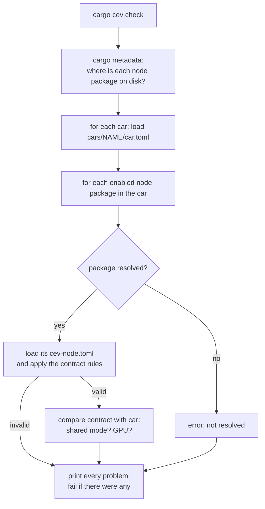
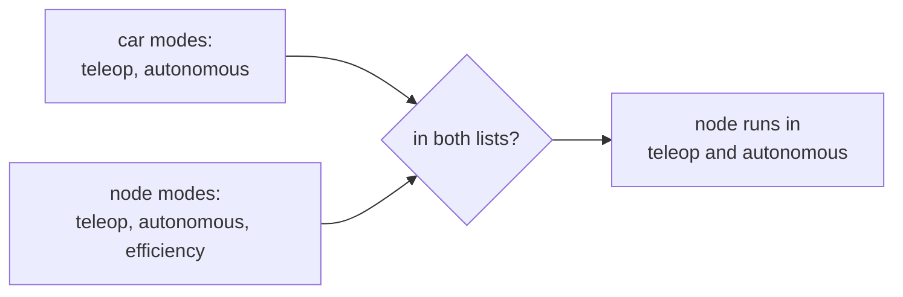

# Checking

`cargo cev check` answers one question: can each car run the nodes it names?
Run it after any change to a car, a contract, or `Cargo.lock`. It also runs
as a test (`every_car_node_has_valid_contract` in `cev-cli`), so `cargo test`
catches the same problems.

```bash
cargo cev check            # every car
cargo cev check sim        # one car
```

## What it does



Step by step:

1. **Find the nodes.** `cargo metadata` lists every package Cargo resolved,
   including the node repos pulled in by `crates/cev-nodes`, and where each one
   is checked out (under `~/.cargo/git`, or your local clone if you use a
   `[patch]`; see [RUNNING.md](../../RUNNING.md#working-on-a-node)).
2. **Load each car** in `cars/`. A car must have `kind`, `gpu` and a non-empty
   `modes` list.
3. **Load each node's contract** from `<package dir>/cev-node.toml` and apply
   the [contract rules](contracts.md#the-rules).
4. **Check the node against the car** (below).
5. **Report everything** and exit with failure if anything was wrong.

## Node against car

These checks need both files, so they live in their own list,
`CarCompatibilityProblem`, separate from the contract's own rules.

The car's side, from `cars/merceves/car.toml`:

```toml
name = "merceves"
description = "MerCEVes autonomous testbed (Jetson)"
kind = "real"
modes = ["teleop", "autonomous"]
gpu = true
```

| Check | Problem name | Fails when |
| --- | --- | --- |
| The node and the car share at least one mode | `NoSharedMode` | The node would never start on this car |
| A GPU node is on a car with a GPU | `NeedsGpu` | The contract says `device = "gpu"` and the car says `gpu = false` |

**Modes come from both sides.** The car lists the modes it supports. The node
lists the modes it runs in. In a given mode, the nodes that should run are the
car's enabled nodes whose contract lists that mode:



A node has to list its modes explicitly. That way, adding a new mode later
never quietly starts a node (say, a controller) that was not written for it.

> **Planned.** Today `check` only tests that the two lists overlap at all.
> Starting only the nodes for one mode (`cargo launch <car> --mode <mode>`) is
> planned, not built.

`gpu = false` on `sim` is deliberate: the sim car has to run on a Mac too.

## What success looks like

Real output on the current branch:

```text
 CHECKING  car merceves (1 node(s))
 FOUND     holdover-ekf /home/you/.cargo/git/checkouts/holdover-ekf-9d61a9254c61a930/d62d50e/cev-node.toml
 CHECKING  car sim (1 node(s))
 FOUND     holdover-ekf /home/you/.cargo/git/checkouts/holdover-ekf-9d61a9254c61a930/d62d50e/cev-node.toml
 FINISHED  no problems
```

## What failure looks like

Say someone writes a contract for a new camera detector and makes four
mistakes: a leading `/` on a topic, a message type that does not exist, a
rate of zero, and a GPU requirement. The messages below are the exact text the
code produces (captured by loading such a file with `cev-config`).

The contract's own rules, all reported together (`cev check` prints this
after the contract's path):

```text
contract violations:
 - topic `/sensors/zed/image` is not a usable Zenoh key: no leading or trailing `/`
 - topic `perception/obstacles`: unknown type `Obstacles` (not a sensor_defs::MsgType)
 - topic `perception/obstacles`: 0 Hz is not a positive, finite rate
```

Fix those, then put the node (`modes = ["efficiency"]`, `device = "gpu"`) on
the `sim` car, which supports only `teleop` and `autonomous` and has
`gpu = false`. `cev check` prints one `ERROR` line per problem, prefixed with
the package name (shown here as `my-detector`):

```text
my-detector: shares no mode with the car, so it would never start
my-detector: needs a GPU (runtime `tensorrt`), but the car has `gpu = false`
```

The run then ends with `2 problem(s)` and a failing exit code.

If a car names a package that the stack does not pull in, you get:

```text
node package `my-detector` is not resolved (is it a dependency in crates/cev-nodes/Cargo.toml?)
```

## Not checked yet

The biggest missing piece is checking nodes **against each other**. It is
planned (the "graph check"), not built. For every mode a car supports, it will
check that:

- every input topic has exactly one node publishing it,
- the publisher's type matches the subscriber's type,
- the publisher's `rate_hz` is at least the subscriber's `min_rate_hz`.

For example, today both cars run only `holdover-ekf`, and nothing in the stack
publishes `sensors/imu` or `sensors/gps` yet. The current check passes; the
graph check will flag it. A simulated sensor node that publishes those topics
is planned.
