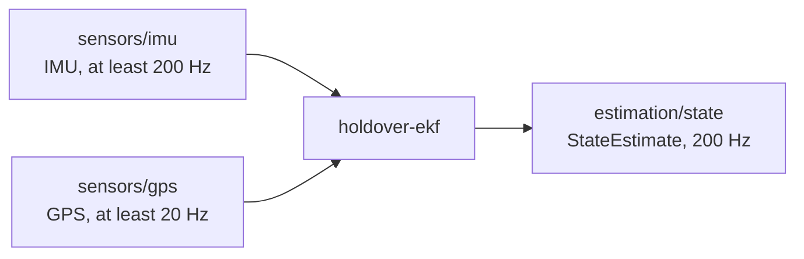

# Contracts

A contract is a file named `cev-node.toml` that sits next to a node's
`Cargo.toml`. It is the node's promise to the rest of the stack: "give me
these topics at these rates, and I will publish these topics; I run on this
hardware, in these modes."

**Your code does not read this file**, and nothing checks that the code really
does what the contract says. If you change what your node subscribes to or
publishes, update `cev-node.toml` by hand in the same commit.

The format is TOML, the same as `Cargo.toml` and `car.toml`. The list of
allowed fields lives in
[`crates/cev-config/src/contract.rs`](../../crates/cev-config/src/contract.rs).
(Why a separate file at all? See
[Design and status](design-and-status.md#why-it-works-this-way).)

## A real example

This is the contract `holdover-ekf` ships, in the version `Cargo.lock` pins as
of 2026-10-26:

```toml
# Node contract: what holdover-ekf promises the rest of the stack that it has.
# Read by `cev check` in rust-autonomy-stack root.
contract_version = 1
role = "estimation"
description = "5 state temporary EKF [P_e, P_n, Psi, V, B_w] on IMU + GPS"
modes = ["teleop", "autonomous", "efficiency"]

[compute]
device = "cpu"

[[inputs]]
topic = "sensors/imu"
type = "IMU"
min_rate_hz = 200.0

[[inputs]]
topic = "sensors/gps"
type = "GPS"
min_rate_hz = 20.0

[[outputs]]
topic = "estimation/state"
type = "StateEstimate"
rate_hz = 200.0

[[metrics]]
name = "NIS"
when = ["sim", "real"]
```

It runs on the CPU in every mode and promises a state estimate at 200 Hz
(proposed; see [Still open](design-and-status.md#still-open)). `NIS` is a
filter-consistency number it reports both in simulation and on the real car.
As a picture, the contract describes one box and its arrows; the stack's job
is to make sure every arrow on a car connects to something:



## Fields

| Field | Required | Meaning |
| --- | --- | --- |
| `contract_version` | yes | Format version. Must be `1` today. |
| `role` | yes | Free text: `estimation`, `planning`, `perception`, ... For people; not checked. |
| `description` | no | Free text. |
| `modes` | yes | Which modes this node runs in. Any of `teleop`, `autonomous`, `efficiency`. Must not be empty. |
| `[compute]` | yes | `device = "cpu"`, or `device = "gpu"` plus a `runtime` (see below). |
| `[run]` | no | `bin` (which binary in the package; default: the binary named after the package) and `args`. **Read but not used yet**; see below. |
| `[[inputs]]` | no | One per topic the node subscribes to: `topic`, `type`, `min_rate_hz` (the slowest rate it can live with). |
| `[[outputs]]` | no | One per topic the node publishes: `topic`, `type`, `rate_hz`. |
| `[[metrics]]` | no | `name`, and `when = ["sim"]`, `["real"]` or both. |

A GPU node names the runtime it needs, such as `cuda`, `tensorrt` or `onnx`.
`model` is optional, because some GPU nodes run plain parallel code with no
model file:

```toml
[compute]
device = "gpu"
model = "models/yolo.onnx"
runtime = "tensorrt"
```

`runtime` is free text for now; the allowed values are still an open question.

> **Built vs planned.** The stack reads every field above, but checks only
> the ones in [The rules](#the-rules) and [Node against car](checking.md#node-against-car).
> `cargo launch` and `cargo deploy` do not act on the contract yet: they take
> what to run from `car.toml`, ignore `[run]`, and do not filter nodes by mode
> or turn metrics on and off. If your package has several binaries, set `bin`
> on the car's `[[nodes]]` entry for now. See
> [Status](design-and-status.md#status).

## The rules

The stack refuses an invalid contract. Two kinds of mistakes are caught.

**A field that is not allowed, or is missing.** A missing required field, an
unknown field (`min_rate = 200.0` instead of `min_rate_hz`), an unknown mode
such as `"teleopp"`, or a GPU without a `runtime`. Only the first such error
is reported. **Exception:** inside `[compute]`, unknown fields are silently
ignored, so a typo like `modle = "..."` under a GPU, or a `runtime` under
`device = "cpu"`, passes without a word.

**The file reads fine but breaks a rule.** These are all collected and
reported together:

| Rule | You'll see | Example that fails |
| --- | --- | --- |
| Version is the one this cev reads | ``contract_version = 2, but this cev reads version 1`` | `contract_version = 2` |
| At least one mode | `` `modes` is empty, so this node never runs `` | `modes = []` |
| Rates are positive and finite | ``topic `sensors/imu`: 0 Hz is not a positive, finite rate`` | `rate_hz = 0.0` |
| Topic is a valid topic name | ``topic `/sensors/imu` is not a usable Zenoh key: no leading or trailing `/` `` | `/sensors/imu`, `sensors//imu`, `sensors/*` |
| Type is a known message type | ``topic `perception/obstacles`: unknown type `Obstacles` (not a sensor_defs::MsgType)`` | `type = "Obstacles"` |
| A topic appears once per section | ``topic `sensors/gps` is listed twice in `inputs` `` | two `[[inputs]]` both on `sensors/gps` |

**Topic names.** No leading or trailing `/`, no empty pieces (`//`), no `#`
or `?`, and no `*` or `$` anywhere in the name. `*` and `$` are how Zenoh
writes wildcards, and a wildcard names many topics at once; every topic in a
contract must name exactly one.

**Message types.** A type must be one of the names in the `MsgType` list in
the `sensor-defs` package (repo `rust-autonomy-sensors`, branch
`extra-sensors`): `IMU`, `GPS`, `ZedImage`, `ZedDepth`, `StateEstimate`. Two
nodes writing the same string is not enough; the string must name a type that
exists. To add a type, add it to `MsgType` first.

See [Checking](checking.md#what-failure-looks-like) for what these errors look
like on screen.
