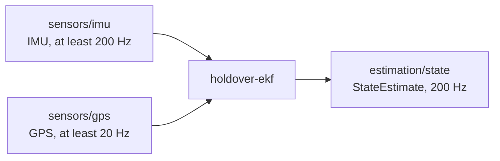

# Contracts

A contract is a file named `cev-node.toml` that sits next to a node's
`Cargo.toml`. It is the node's promise to the rest of the stack: "give me
these topics at these rates, and I will publish these topics; I run on this
hardware, in these modes."

The format is TOML, the same as `Cargo.toml` and `car.toml`. The schema lives
in [`crates/cev-config/src/contract.rs`](../../crates/cev-config/src/contract.rs).

## A real example

This is the contract `holdover-ekf` ships today (commit `d62d50e`, the one
`Cargo.lock` pins):

```toml
# Node contract: what holdover-ekf promises the rest of the stack that it has.
# Read by `cev check` in rust-autonomy-stack root.
contract_version = 1
role = "estimation"
description = "5 state temporary EKF [P_e, P_n, Psi, V, B_w] on IMU + GPS"
modes = ["teleop", "autonomous", "efficiency"]

[compute]
device = "cpu"

[[inputs]]
topic = "sensors/imu"
type = "IMU"
min_rate_hz = 200.0

[[inputs]]
topic = "sensors/gps"
type = "GPS"
min_rate_hz = 20.0

[[outputs]]
topic = "estimation/state"
type = "StateEstimate"
rate_hz = 200.0

[[metrics]]
name = "NIS"
when = ["sim", "real"]
```

Read it top to bottom: an estimator that runs on the CPU in every mode, needs
IMU data at 200 Hz or faster and GPS at 20 Hz or faster, and publishes a state
estimate at 200 Hz. It reports its NIS (a filter-consistency number) both in
simulation and on the real car.

As a picture, the contract describes one box and its arrows. The stack's job
is to make sure every arrow on a car connects to something.



## Fields

| Field | Required | Meaning |
| --- | --- | --- |
| `contract_version` | yes | Schema version. Must be `1` today. |
| `role` | yes | Free text: `estimation`, `planning`, `perception`, ... For people; not checked. |
| `description` | no | Free text. |
| `modes` | yes | Which modes this node runs in. Any of `teleop`, `autonomous`, `efficiency`. Must not be empty. |
| `[compute]` | yes | `device = "cpu"`, or `device = "gpu"` plus a `runtime` (see below). |
| `[run]` | no | `bin` (which binary in the package) and `args`. Without it, the package's default binary runs with no arguments. |
| `[[inputs]]` | no | One per topic the node subscribes to: `topic`, `type`, `min_rate_hz` (the slowest rate it can live with). |
| `[[outputs]]` | no | One per topic the node publishes: `topic`, `type`, `rate_hz`. |
| `[[metrics]]` | no | `name`, and `when = ["sim"]`, `["real"]` or both. |

A GPU node names the runtime it needs. `model` is optional, because some GPU
nodes run plain parallel code with no model file:

```toml
[compute]
device = "gpu"
model = "models/yolo.onnx"
runtime = "tensorrt"
```

`runtime` is free text for now; the allowed values are still an open question.

> **Built vs planned.** The stack reads and checks every field above, but
> `cev launch` and `cev deploy` do not act on all of them yet: they still take
> the binary to run from `car.toml`, ignore `[run]`, and do not filter nodes by
> mode or turn metrics on and off. Those steps are planned; see
> [Status](design-and-status.md#status).

## The rules

A contract is loaded with `NodeContract::load` (or `from_toml_str`). Loading
**refuses** an invalid contract, so code that holds a `NodeContract` knows it
is valid. Two kinds of mistakes are caught:

**The file does not match the schema.** A missing required field, a field the
schema does not know (typos included), an unknown mode such as `"teleopp"`, or
a GPU without a `runtime`. These stop at the first error, like any TOML parse.

**The file parses but breaks a rule.** These are all collected and reported
together, so you fix everything in one pass:

| Rule | Problem name | Example that fails |
| --- | --- | --- |
| Version is the one this `cev` reads | `UnsupportedVersion` | `contract_version = 2` |
| At least one mode | `NoModes` | `modes = []` |
| Rates are positive and finite | `BadRate` | `rate_hz = 0.0` |
| Topic is a usable Zenoh key | `BadTopic` | `/sensors/imu`, `sensors//imu`, `sensors/*` |
| Type is a known message type | `UnknownType` | `type = "Obstacles"` |
| A topic appears once per section | `DuplicateTopic` | two `[[inputs]]` both on `sensors/imu` |

**Topic names.** No leading or trailing `/`, no empty pieces (`//`), no `#`
or `?`, and no wildcards (`*`, `**`, `$*`). A wildcard names many topics at
once, and every topic in a contract must name exactly one.

**Message types.** A type must be one of the names in `sensor_defs::MsgType`
(in `rust-autonomy-sensors`, branch `extra-sensors`): `IMU`, `GPS`,
`ZedImage`, `ZedDepth`, `StateEstimate`. Two nodes writing the same string is
not enough; the string must name a type that exists. To add a type, add it to
`MsgType` first.

See [Checking](checking.md) for what these errors look like on screen.

## Why a separate file?

- **It is data, not code.** Anyone can read it without knowing the node's
  internals, and the stack can check it without compiling the node.
- **It lives with the node.** The person who changes what a node publishes
  updates the contract in the same commit.
- **It is its own file, not a section of `Cargo.toml`**, so the same format
  could describe a non-Rust node later.

More "why not X?" answers are in [Design and status](design-and-status.md).
